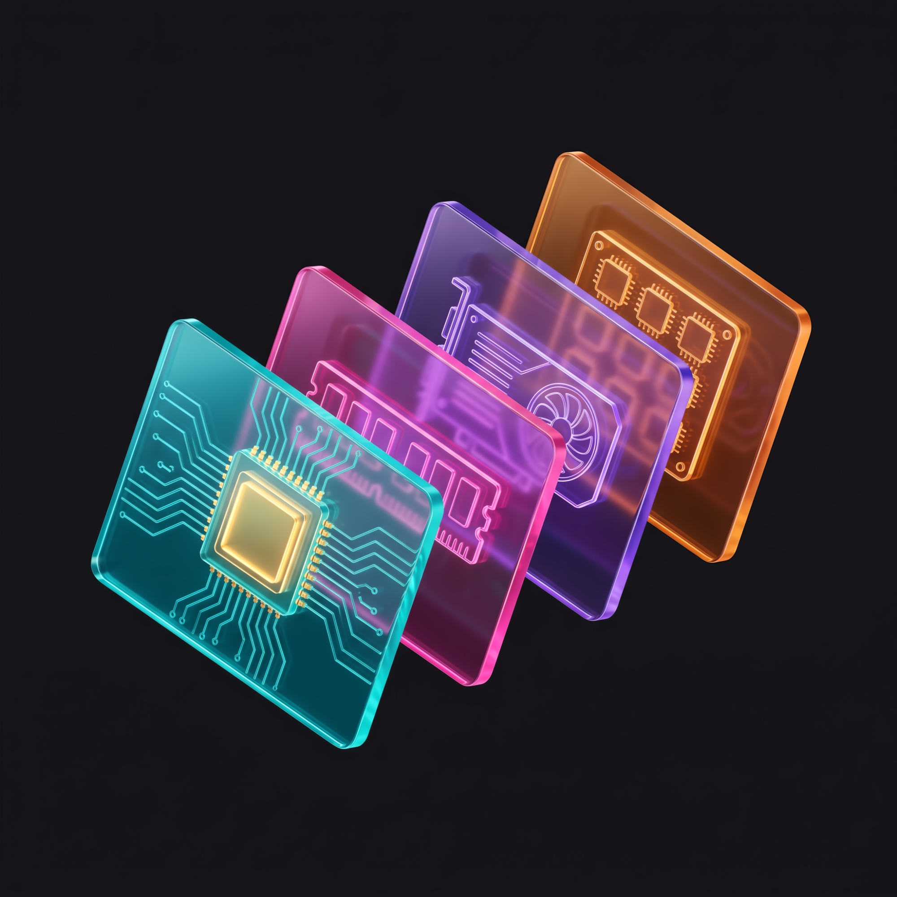
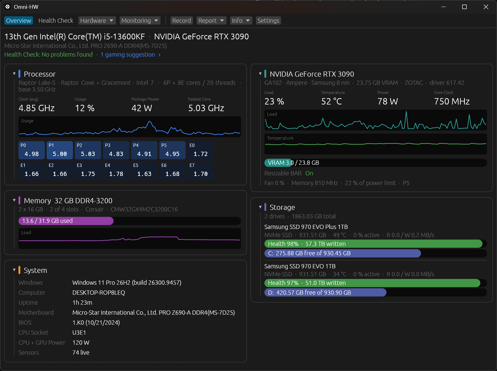

<p align="center">
  
</p>

<h1 align="center">Omni-HW</h1>

<p align="center">
  <b>Your whole PC, explained.</b><br>
  CPU-Z, GPU-Z and HWiNFO-style info in one fast Windows app, plus a Health Check that tells you what's wrong and how to fix it.
</p>

<p align="center">
  🦀 Written in Rust · 🪟 Windows 10/11 · 🚫 No driver · 📦 Single exe · 🔒 100% offline
</p>

<p align="center">
  
</p>

---

## ✨ What can it do?

### 🏠 One-page dashboard
See your CPU, GPU, memory, storage and system at a glance, with live numbers, history graphs and a tile for every CPU core. Colors warm up as things get busy: **blue** is fine, **orange** is worth a look, **red** needs attention.

### 🩺 Health Check
25 automatic checks that spot common problems and explain them in plain English, with step-by-step fixes. A few favorites:

- 🖥️ Monitor plugged into the **motherboard** instead of the graphics card (it happens to everyone!)
- 🐏 RAM running slower than it's rated for (XMP/EXPO off), or stuck in single channel
- 🔥 GPU or drives running hot, drives filling up or wearing out
- 🧬 Outdated microcode on Intel 13th/14th Gen CPUs
- 🎮 A separate **Gaming** section: Resizable BAR, Game Mode, GPU scheduling and more
- 🛡️ Security-related settings are clearly flagged, so you don't change them by accident

### 🔍 Hardware details
Everything you'd expect from CPU-Z and GPU-Z: CPU model, codename, cores and threads (P/E cores), caches and instruction sets; motherboard and BIOS; every memory stick; GPU chip, VRAM, driver, PCIe link and Resizable BAR; and drive health for both NVMe and SATA drives.

### 📈 Live sensors
HWiNFO-style readings with current, min, max and average: per-core clocks and usage, CPU power, GPU load, temperature, clocks, power and fan, memory, and disk speed and temperature.

### ⏺️ Recording & analysis
- Record every sensor to a CSV with one click, from any page.
- **Compare** two sessions side by side. Did that repaste actually help? 🤔
- **Bottleneck analysis** tells you whether a game was CPU-bound, GPU-bound or limited by a frame cap.

### 🔔 Alerts
Set rules like *"GPU above 85 °C for 30 seconds"* and get a Windows notification when one trips.

### 📝 Reports
Save a tidy HTML report or copy a text one, handy for asking for help on forums.

### 🎨 Comfort features
Dark or light theme · adjustable UI scale · compact menus with ↑/↓ arrow-key paging · minimize to the system tray · launch at sign-in · a built-in feature guide (**Info → Feature guide**).

---

## 🚀 Getting started

### Download & run
Grab `omnihw.exe` from the [Releases](../../releases) page and double-click it. That's it: no installer, no driver.

### Build it yourself
You'll need:
- [Rust](https://rustup.rs) (stable, MSVC toolchain)
- Visual Studio Build Tools with the **C++ workload** and a **Windows SDK**

```
cargo run -p omnihw-app --release
```

The app lands in `target\release\omnihw.exe`. Run the tests with `cargo test --workspace`.

### Handy command-line options
| Option | What it does |
|---|---|
| `--no-elevate` | Skip the administrator prompt at start |
| `--autostart` | Used by "launch at sign-in"; never shows the administrator prompt |
| `--minimized` | Start minimized (to the tray, if that setting is on) |

---

## 🔒 Privacy & permissions

- 🌐 **Offline:** Omni-HW never connects to the internet. Everything stays on your PC.
- 🧩 **No driver:** it uses standard Windows APIs and your GPU driver's own monitoring library. Nothing gets installed.
- 🛡️ **Admin only for SATA health:** reading SATA drive health needs administrator rights, so Omni-HW asks once at start if you have SATA drives. Say no and everything else still works, or turn the prompt off in Settings. NVMe drives don't need it.
- 📁 **Where your files go:**
  - Settings: `%APPDATA%\OmniHW\settings.ini`
  - Alert rules: `%APPDATA%\OmniHW\alerts.tsv`
  - Recordings & reports: your Documents folder (or the folder you pick in Settings)
  - "Launch at sign-in" adds an `Omni-HW` entry under `HKCU\Software\Microsoft\Windows\CurrentVersion\Run`; turning it off removes it

---

## 🗂️ Project layout

```
crates/
  omnihw-core/   hardware detection, sensors, Health Check, recording & analysis
                 (zero external dependencies, thoroughly unit-tested)
  omnihw-app/    the desktop app (egui/eframe)
Assets/Brand/    logo, app icon and screenshots
```

## 🛣️ Roadmap

- 🌡️ Per-core CPU temperatures, fans and voltages (optional signed-driver backend)
- ⏱️ Quick memory and disk self-tests with "what's normal for your hardware" ranges

---

## ™️ Trademarks

CPU-Z is a trademark of CPUID. GPU-Z is a trademark of TechPowerUp. HWiNFO is a trademark of Martin Malík (REALiX). Omni-HW is an independent project and is not affiliated with or endorsed by them.

## 📄 License

[MIT](LICENSE). Use it, fork it, tinker with it. 🛠️
